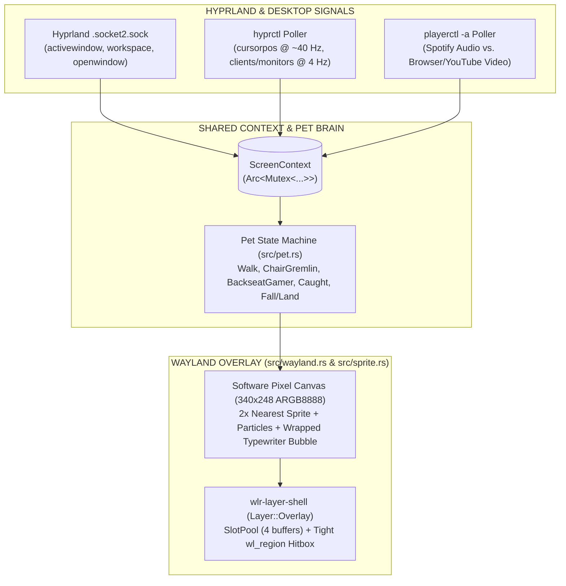

<div align="center">

# Futaba (`desktop-pet`)

**Native Hyprland / Wayland Desktop Companion featuring Futaba Sakura (Oracle)**

*A zero-compositor-bloat Rust overlay pet that roams your screen, perches on windows, reacts in real time to your apps and media, and flies with physics when tossed.*

<br/>

<p align="center">
  <a href="https://github.com/Faewon/desktop-pet"></a>
  <a href="https://www.rust-lang.org/"></a>
  <a href="https://hyprland.org/"></a>
  <a href="assets/futaba.json"></a>
</p>

</div>

---

> [!IMPORTANT]
> **WHY A NATIVE `wlr-layer-shell` PET?**
>
> Electron or GTK-heavy desktop toys eat hundreds of megabytes of RAM, steal keyboard focus, or break click-through on Wayland. `desktop-pet` talks directly to Wayland (`smithay-client-toolkit`) on `Layer::Overlay` with a tight dynamic `wl_region` hitbox—making Futaba click-through everywhere except her sprite, completely non-intrusive to typing, and visible even above borderless fullscreen games.

> [!NOTE]
> **Environment scope & prerequisites**
> - Built specifically for **Hyprland on Wayland** (reads window geometry, active focus, monitor scale, and cursor coordinates via `hyprctl` and Hyprland's `.socket2.sock`).
> - Media detection (`Spotify` music vs. `YouTube` / browser video) uses `playerctl -a` (MPRIS). Without `playerctl`, screen and cursor reactions still work normally.
> - Embeds the default 41-frame `68×68` pixel sheet ([assets/futaba.png](assets/futaba.png)) directly into the compiled binary (`include_bytes!`).

---

## Feature Overview

| Trigger / Activity | State & Animation | Behavior & Sample Dialogue |
| :--- | :--- | :--- |
| **Coding (`kitty`, `nvim`, editors)** | `ChairGremlin` (`8 FPS`) / `CodeCheer` | Squatting in her rolling chair at a glowing laptop on a two-legged desk, emitting `CodeBit` particles (*"Alibaba mode! Bypassing firewall~"*). |
| **Cursor Sneak While Hacking** | `Caught` (3-stage sequence) | Triggers `!` alert (*"Eek! Don't look at my screen!!"*), ducks behind her chair (`Freeze → Hide`), trembles if hovered, then slowly peeks back. |
| **Gaming (`Steam`, `Gamescope`, etc.)** | `BackseatGamer` (`7 FPS`) | Mashes a controller with LED sparks (*"Navigator ready! Don't feed, okay?"*), keeps out of your crosshair, and ignores mouse-idle sleep. |
| **Music (`Spotify`, MPRIS audio)** | `Vibe` | Bops to the beat with floating music notes and announces the track (*"♪ BGM set: ..."*). |
| **Video (`YouTube`, `mpv`, `vlc`)** | `Snack` / `Sit` | Slurps instant yakisoba noodles or chills on a ledge (*"Is this lore? Wait, no spoilers!"*). |
| **Idle (`> 45s` inactive)** | `Sleep` | Curls up with `Zzz` particles (*"Zzz... 12 hours max..."*) until you move or switch windows. |
| **Left-Drag, Throw & Drop** | `Dragged` → `Fall` → `Land` | Curls into a panicked ball, launches with flick-proportional throw velocity + wall/ceiling ricochets, flails in mid-air, and lands in a 2-stage **Superhero Landing**. |

---

## Core Capabilities Grid

| Wayland Overlay & Hitbox | Physics & Window Perching | Sprite & Speech Engine | Real-Time IPC Watcher |
| :--- | :--- | :--- | :--- |
| • `Layer::Overlay` (`wlr-layer-shell`)<br/>• Renders over borderless fullscreen<br/>• Dynamic `wl_region` click-through<br/>• `KeyboardInteractivity::None` | • Flick-proportional throw velocity<br/>• Damped wall & ceiling bounces<br/>• Perches on Hyprland window edges<br/>• 2-stage Superhero Landing (`0.48s`) | • Embedded 41-frame `68×68` sheet<br/>• Custom `5×7` pixel bitmap font<br/>• Word-wrapped multi-line bubbles<br/>• `34 chars/s` typewriter reveal | • Hyprland `.socket2.sock` events<br/>• `hyprctl -j` geometry & cursor poll<br/>• `playerctl -a` audio/video split<br/>• Zero-lock background threads |

---

## System Architecture



---

## Controls & Modes

| Input | Action |
| :--- | :--- |
| **Left-click** | Pet Futaba (headpats, mini-hop, hearts, and RPG buff quips) |
| **Left-drag / Flick** | Pick her up (`Dragged`), drop her onto a window ledge, or toss her across the screen |
| **Right-click** | Cycle navigator mode: `Nav: Auto Support!` → `Nav: Follow Cursor!` → `Nav: Camp Here` |
| **Double middle-click** | Prompt & confirm quit (`"Middle-click again to log out!"`) |

---

## Repository Structure

```text
desktop-pet/
├── assets/
│   ├── futaba.json          # Frame index map (41 frames, 68x68)
│   └── futaba.png           # Embedded pixel-art sprite sheet (2788x68)
├── scripts/
│   ├── build_futaba_run.py          # Packs/polishes Futaba frames & easter-egg loops
│   └── process_generated_sheet.py   # Chroma-key, despill & frame alignment helpers
├── src/
│   ├── context.rs           # Hyprland socket2/hyprctl & playerctl MPRIS watcher
│   ├── main.rs              # CLI args (--sprite) & thread startup
│   ├── pet.rs               # State machine, physics, throw bounces, reactions & dialogue
│   ├── sprite.rs            # PNG loader, ARGB8888 canvas, particles & typewriter bubbles
│   └── wayland.rs           # wlr-layer-shell overlay, wl_region hitbox & drag velocity
├── Cargo.toml
└── Cargo.lock
```

---

## Quick Start Guide

### Prerequisites
- Linux running **Hyprland** (`hyprctl`) on **Wayland**
- **Rust toolchain** (`cargo`, 2021 edition)
- *(Optional)* `playerctl` for Spotify/YouTube media distinction

### Build & Run

```bash
git clone https://github.com/Faewon/desktop-pet.git
cd desktop-pet
cargo build --release
./target/release/desktop-pet
```

To test an alternate sprite sheet at runtime (optional JSON sidecar supported):

```bash
./target/release/desktop-pet --sprite path/to/sheet.png
```

### Hyprland Autostart & Toggle Hotkey (`user.lua`)

If using a Lua Hyprland config (`~/.config/hypr/user.lua`):

```lua
-- Launch Futaba on startup and toggle with Super+Shift+F
hl.on("hyprland.start", function()
    hl.exec_cmd("sleep 1 && (pgrep -x desktop-pet >/dev/null || /path/to/desktop-pet/target/release/desktop-pet)")
end)
hl.bind(
    "SUPER + SHIFT + F",
    hl.dsp.exec_cmd("pkill -x desktop-pet || /path/to/desktop-pet/target/release/desktop-pet")
)
```

Or in standard `hyprland.conf`:

```ini
exec-once = /path/to/desktop-pet/target/release/desktop-pet
```

### Verification & Checks

Run lints and the 9 unit tests (covering activity classification, media parsing, bubble wrapping, ledge landing, mid-air fall lock, gaming mode, throw bounces, and embedded sheet rendering):

```bash
cargo clippy --all-targets -- -D warnings
cargo test
```
